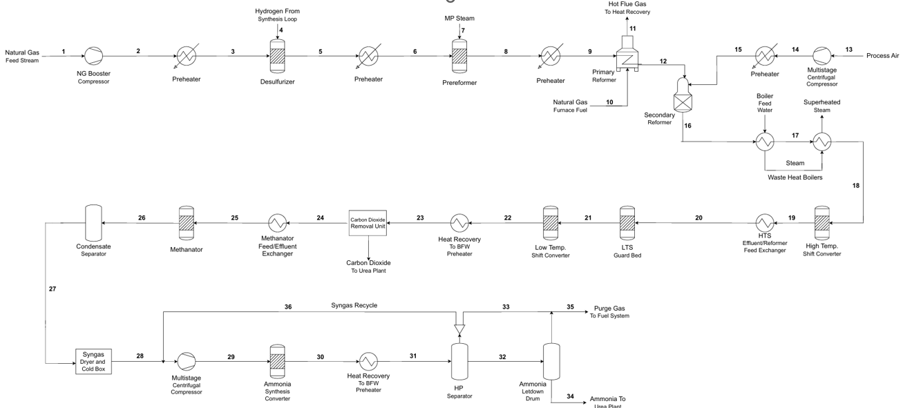
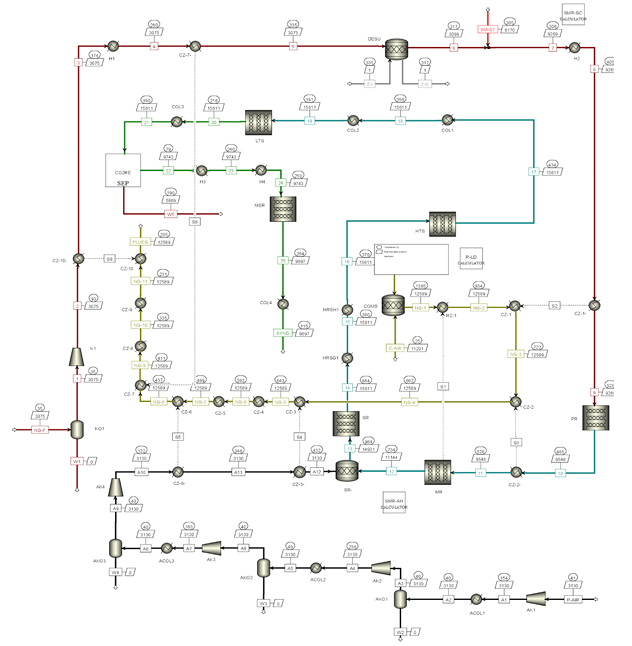
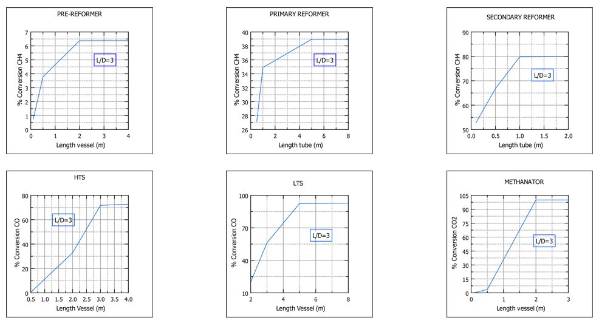
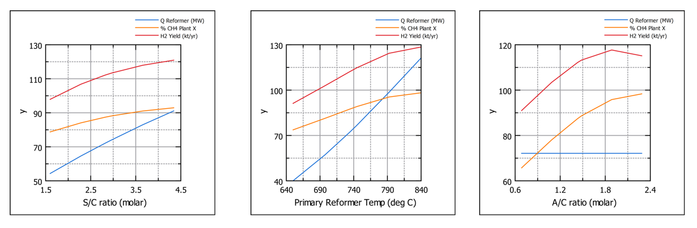

# Design and Energy Optimization of an Ammonia Production Unit

**Final Year Design Project | Chemical Engineering | NUST | 2025**

---

## <u>Project Overview</u>

This project focused on the process design and energy optimization of an industrial ammonia production unit based on the Haber–Bosch process. The study investigated reactor design, operating conditions, energy requirements, and process efficiency.

Aspen Plus V14 was used to simulate the ammonia production process and conduct sensitivity analyses. The project also incorporated material and energy balances, reactor kinetics, equipment design, preliminary economic evaluation, process control, and HAZOP analysis.

## <u>Project Objectives</u>

- Develop an Aspen Plus simulation of an ammonia production unit.
- Perform material and energy balances across major process units.
- Investigate the influence of reactor dimensions and operating parameters on conversion.
- Identify suitable operating conditions through sensitivity analysis.
- Design selected process equipment and assess preliminary economic feasibility.
- Evaluate process safety and control requirements.

## <u>Ammonia Production Process</u>

The simulated process follows the principal stages of conventional ammonia production:

1. **Feed preparation and desulfurization:** Removal of sulfur compounds from the natural gas feed.
2. **Steam reforming:** Conversion of hydrocarbons into hydrogen-rich synthesis gas.
3. **Secondary reforming:** Further reforming with air, which also introduces nitrogen for ammonia synthesis.
4. **Shift conversion:** Conversion of carbon monoxide into carbon dioxide while producing additional hydrogen.
5. **Carbon dioxide removal and methanation:** Removal of carbon dioxide and residual carbon oxides.
6. **Ammonia synthesis:** Reaction of hydrogen and nitrogen to produce ammonia, followed by product separation.

### Overall Process Diagram

> **Figure:** General ammonia production process.

## <u>Aspen Plus Process Simulation</u>

The ammonia production process was modelled in Aspen Plus V14. The flowsheet represents the major process units and their interconnecting streams.

> **Figure 1:** Aspen Plus process flow diagram developed for the ammonia production unit (Figure 22 in the thesis, printed page 73).

## <u>Methodology</u>

### 1. Process Simulation

- Developed the ammonia production flowsheet in Aspen Plus V14.
- Configured process components and thermodynamic property methods, including Peng–Robinson, SRK, and Steam NBS, as documented in the project report.
- Applied Langmuir–Hinshelwood–Hougen–Watson (LHHW) kinetics to the pre-reformer, primary reformer, and secondary reformer.
- Used simplified rate expressions for the high-temperature shift converter, low-temperature shift converter, and methanator.

### 2. Material and Energy Balances

Material balances were performed across the major process units. Energy balances and equipment calculations supported the assessment of process requirements and design parameters.

### 3. Reactor Design and Sensitivity Analysis

The influence of reactor dimensions on reactant conversion was investigated while maintaining a length-to-diameter ratio of 3 in the reported sensitivity study.

The reported optimum reactor tube lengths were:

| Reactor | Optimum tube length |
|---|---:|
| Pre-reformer | 2 m |
| Primary reformer | 5 m |
| Secondary reformer | 1 m |
| High-temperature shift converter (HTS) | 3 m |
| Low-temperature shift converter (LTS) | 5 m |
| Methanator | 2 m |

> **Figure 2:** Sensitivity analysis illustrating the relationship between reactor dimensions and conversion.

### 4. Operating-Parameter Optimization

Sensitivity analyses were conducted to investigate the influence of three operating parameters:

- **Steam-to-carbon ratio:** The reported optimum was 2.8, balancing hydrogen production and steam-related energy demand.
- **Primary reformer outlet temperature:** The reported optimum was 734°C.
- **Air-to-carbon ratio:** The reported optimum was 1.9, considering methane conversion, hydrogen production, and nitrogen dilution.

> **Figure 3:** Sensitivity analyses of key operating parameters.

### 5. Equipment Design and Economic Evaluation

The project included selected equipment-design calculations and a preliminary economic assessment, covering:

- Reactor and converter design.
- Heat-exchanger calculations, including heat duty, log mean temperature difference (LMTD), overall heat-transfer coefficient, and pressure drop.
- Equipment cost estimation and capital investment.
- Operating-cost and payback-period estimates.

### 6. Process Control and Safety

The project also addressed process control and safety through:

- Instrumentation and process control-loop diagrams.
- Identification of key process variables.
- HAZOP analysis of the primary reformer section.

## <u>Key Findings</u>

- Reactor-length sensitivity analysis identified dimensions beyond which additional length produced limited improvement in conversion.
- The reported operating-parameter optima were a steam-to-carbon ratio of 2.8, primary reformer outlet temperature of 734°C, and air-to-carbon ratio of 1.9.
- The project evaluated process design and operating conditions in relation to conversion and energy requirements.
- Preliminary economic analysis was conducted to estimate investment requirements and payback period.

The project report concluded that the plant was already operating near its optimum conditions, with limited potential for further energy-index improvement through the studied adjustments alone. No quantified plant-wide energy reduction is claimed here.

## <u>Tools and Engineering Skills</u>

- Aspen Plus V14
- Chemical process simulation
- Material and energy balances
- LHHW reaction kinetics
- Reactor design and sensitivity analysis
- Heat-exchanger design
- Preliminary economic evaluation
- Process control and HAZOP

## <u>Project Information</u>

- **Project type:** Final Year Design Project
- **Degree:** Bachelor of Engineering in Chemical Engineering
- **Institution:** National University of Sciences and Technology (NUST), Pakistan
- **Year:** 2025
- **Project format:** Team-based academic project

## <u>Scope and Limitations</u>

This was an academic process-design and simulation study. The reported findings depend on the assumptions, models, and operating conditions documented in the project report. The sensitivity-analysis optima do not, by themselves, establish experimentally validated performance improvements in an operating plant.

## <u>Future Work</u>

- Quantify changes in energy index against a clearly defined baseline.
- Investigate heat integration and waste-heat recovery opportunities.
- Validate simulation results against reliable plant data or published reference cases.
- Extend optimization to additional process and utility constraints.
